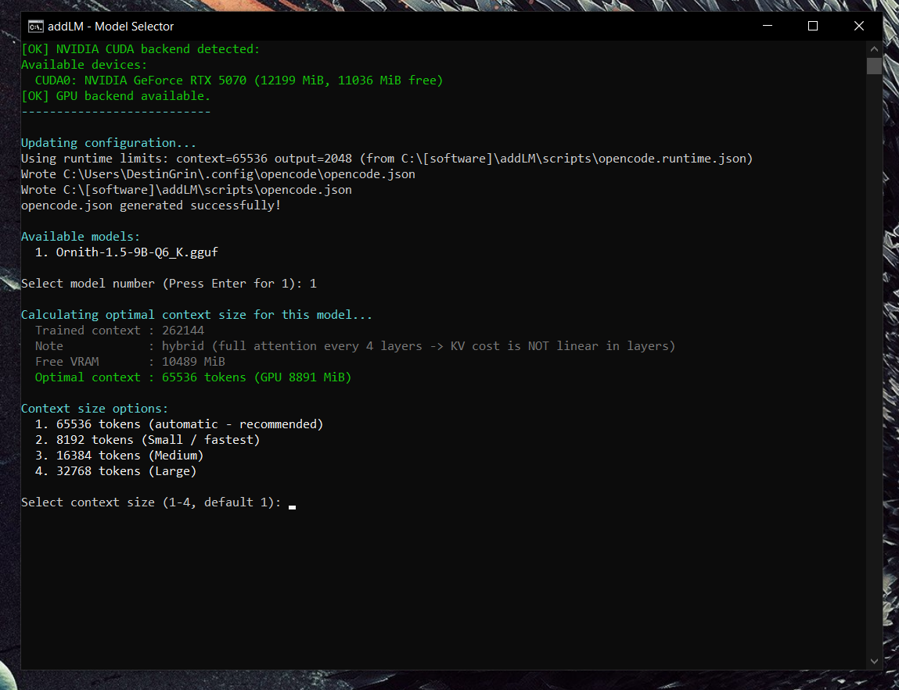

<div align="center">

# addLM

**Local GGUF models in OpenCode, one double-click away.**

<p align="center">
  
</p>

<p align="center"><sub>Pick a model, and addLM calculates the optimal context size from your real VRAM, verifies the GPU, and writes the OpenCode config for you.</sub></p>

<p align="center">
  <a href="LICENSE"></a>
  <a href="#-quick-start"></a>
  <a href="https://github.com/ggml-org/llama.cpp"></a>
  <a href="https://github.com/anomalyco/opencode"></a>
  <a href="https://www.python.org/"></a>
  <a href="https://learn.microsoft.com/powershell/"></a>
  
</p>

</div>

---

**addLM** is a one-click launcher that turns local GGUF models into a working
[OpenCode](https://github.com/anomalyco/opencode) provider. It detects models
in `models/` (including models inside per-model sub-folders), calculates the
**optimal context window** for the selected model from its own metadata and the
real VRAM budget, verifies the GPU backend actually loaded, starts
`llama-server` on `http://127.0.0.1:8081`, and writes a valid `opencode.json`
where OpenCode expects it.

The generated config is **merged** into your existing one, so your own
providers, agents, MCP servers and permissions are preserved.

---

## 📖 Contents

- [Features](#-features)
- [Quick start](#-quick-start)
- [Useful commands](#-useful-commands)
- [What is in the repository](#-what-is-in-the-repository)
- [Safety](#-safety)
- [Project status](#-project-status)
- [License](#-license)
- [References](#-references)

---

## ✨ Features

- **Optimal context size, computed - not guessed.**
  Read straight from the GGUF header plus a real VRAM measurement using
  llama.cpp's own `llama-fit-params`. No hardcoded table and no naive KV-cache
  formula, so hybrid sliding-window models (Gemma 4, Qwen 3.5, MiMo) are sized
  correctly. Works fully offline.
- **The server has the final say.**
  After launch, addLM reads back the context the server *actually* loaded
  (`/props` -> `n_ctx`) and rewrites the OpenCode config to match. Predicted
  and real can never disagree, so OpenCode stops re-triggering compaction
  after every single step.
- **No silent CPU fallback.**
  If the CUDA runtime DLLs are missing, the server would start on the CPU with
  the GPU sitting idle and no error. addLM detects this, reports it, and
  installs the runtime DLLs itself. Only the NVIDIA *driver* is needed - not
  the full CUDA Toolkit.
- **Zero-config OpenCode integration.**
  Generates `%USERPROFILE%\.config\opencode\opencode.json` (the documented
  global location) via merge-on-write, sets `permission.doom_loop = deny` and
  budgets agent steps, so the config never has to be edited by hand.
- **A loop guard that closes the `doom_loop` gap.**
  OpenCode's `doom_loop` permission only catches **byte-identical** tool
  calls. `scripts/plugins/addlm-loop-guard.js` groups repeated calls **by
  resource** instead, so hammering the same file, command, pattern or URL with
  slightly different formatting is caught too. A repeated call is aborted and
  the model is told to change approach, which stops the "same call forever"
  loop that small local models fall into. Ships as an installable OpenCode
  plugin.
- **Measured, not claimed.**
  A one-click safety/refusal benchmark (`safetyTest.bat`) scores a model with
  the published community method - the mlabonne/harmful_behaviors dataset and
  heretic's 33 refusal markers - so its numbers are comparable to published
  figures.
- **Portable.**
  No hardcoded paths anywhere. The folder can be moved to any location,
  including a path containing the wildcard characters `[ ] * ?`.

---

## 🚀 Quick start

```text
1. Drop your .gguf files into  models\
2. Double-click  addLM.bat
3. Pick a model, then a context size (the optimum is calculated for you)
4. The server starts on  http://127.0.0.1:8081
5. Fully restart OpenCode and select the "llama-server" provider
```

**Requirements**

- Windows 10 / 11 (PowerShell 5.1+)
- [llama-server](https://github.com/ggml-org/llama.cpp) - the launcher
  downloads the right build for your GPU (CUDA / Vulkan / CPU) on first run
- Python 3.10+ - installed automatically by the launcher if missing
- NVIDIA driver for GPU use (optional - CPU fallback is supported and sized
  against system RAM instead)

---

## 🔧 Useful commands

```powershell
# Regenerate the OpenCode config without launching
python scripts\fix-models.py --generate-only

# Check the config against the running server (exit 0 = OK)
powershell -NoProfile -ExecutionPolicy Bypass -File scripts\verify-config.ps1

# Recalculate the context size for every model
python scripts\context-calc.py models
```

---

## 📦 What is in the repository

| Path | What it is |
|------|------------|
| `addLM.bat` | Entry point - double-click this |
| `scripts/addLM.ps1` | Main launcher: pre-flight checks, model menu, context calc, launch |
| `scripts/context-calc.py` | Offline VRAM-aware context-size calculator |
| `scripts/context-sync.ps1` | Reads the *real* context back from the running server |
| `scripts/verify-config.ps1` | Asserts the config matches the running server (exit 0 = OK) |
| `scripts/fix-models.py` | Generates / merges the OpenCode config |
| `scripts/safetyTest.*` | Refusal-rate benchmark (mlabonne/harmful_behaviors) |
| `scripts/harmful_*.parquet` | The benchmark dataset |
| `scripts/plugins/addlm-loop-guard.js` | OpenCode plugin that blocks repeated tool calls |
| `scripts/opencode.json` | Reference copy of the generated config |
| `scripts/readme.txt` | Full user documentation |
| `scripts/_HANDOFF.md` | Architecture notes, measurements, resolved issues |
| `docs/addlm-console.png` | The screenshot above |

---

## 🔒 Safety

The launcher enables llama-server's `--agent` tools (`exec_shell_command`,
`write_file`). Never expose port 8081 to a network, and be aware that
abliterated models will answer harmful prompts - the launcher ships a refusal
benchmark precisely so you can measure that yourself.

---

## 📌 Project status

**addLM is a hobby project, published as-is.** It was vibe-coded, mostly with
**MiniMax M3.1 Flash**, and it comes with no guarantee of correctness,
stability or backwards compatibility.

**It is not maintained.** There is no issue-response SLA, no release cadence,
and no promise that a pull request will be reviewed. Feel free to fork it and
make it your own - that is what it is there for. Use it at your own risk.

addLM is not built by, affiliated with, or endorsed by the OpenCode team.

Built on [llama.cpp](https://github.com/ggml-org/llama.cpp) (`0.7.0-dev`, build
11721) and tested against [OpenCode](https://github.com/anomalyco/opencode)
v2.1.0 on Windows.

---

## 📄 License

**MIT** - the most permissive license in common use. See [`LICENSE`](LICENSE).

The bundled `llama.cpp` binaries are **not** covered by this license; they are
downloaded from the official upstream releases, which are MIT-licensed by
[ggml-org](https://github.com/ggml-org/llama.cpp). The
`harmful_*.parquet` dataset is from
[mlabonne/harmful_behaviors](https://huggingface.co/datasets/mlabonne/harmful_behaviors).

---

## 🔗 References

- llama.cpp - https://github.com/ggml-org/llama.cpp
- OpenCode - https://github.com/anomalyco/opencode
- OpenCode issue #45442 (identical tool-call loop) - https://github.com/anomalyco/opencode/issues/45442
- OpenCode issue #41801 (degenerate compaction) - https://github.com/anomalyco/opencode/issues/41801
- Refusal benchmark method (heretic) - https://github.com/p-e-w/heretic/blob/master/src/heretic/scorers/keyword_rate.py
